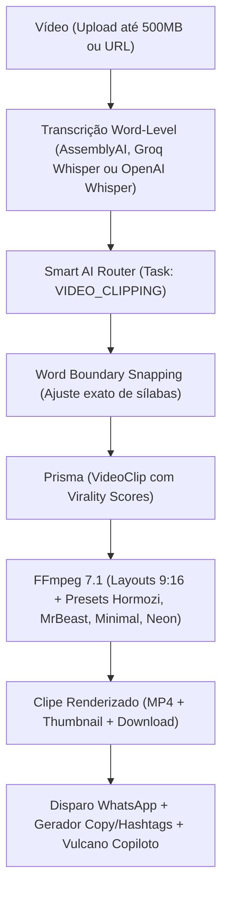

# 🎬 SupoClip — Fábrica de Cortes Virais & Vídeos IA no ZapSender

## 📌 Visão Geral
O **SupoClip** é a central unificada do ZapSender para transformar podcasts, palestras, entrevistas e vídeos longos em cortes curtos de alta retenção (**9:16 Vertical, 1:1 Quadrado, 4:5 Retrato e 16:9 Horizontal**) formatados para **Instagram Reels, TikTok, YouTube Shorts, Feed do Instagram/LinkedIn e YouTube tradicional**.

A funcionalidade opera tanto pela interface visual no painel web quanto de forma 100% autônoma através do **Piloto Automático** e comandos de texto ou áudio enviados ao **Vulcano Copiloto**.

---

### 🤖 Integração com as IAs Nativas do ZapSender
1. **Detecção de Ganchos e Viralidade:** Usa 100% o **Smart AI Router**, aproveitando diretamente o provedor de IA padrão já conectado na empresa (OpenRouter, OpenAI, Groq, Anthropic, Gemini, DeepSeek, etc.). Não exige chaves duplicadas.
2. **Transcrição de Áudio (Word-Level Timestamps):** Detecta e reutiliza automaticamente as chaves de **Groq Whisper** (`whisper-large-v3`) ou **OpenAI Whisper** (`whisper-1`) já salvas no painel de Provedores de IA do ZapSender. O AssemblyAI permanece disponível para diarização de participantes.
3. **Multi-Formato FFmpeg:** Suporta **9:16 Vertical Blur / Crop**, **1:1 Quadrado**, **4:5 Retrato Feed** e **16:9 Widescreen original**, adaptando margens e tamanhos de legendas para não cobrir elementos nativos das redes.

---

### 📥 Downloader Universal & Redes Sociais
* **TikTok Sem Marca d'Água:** Integração com endpoint TikWM e extração do fluxo limpo em HD (`play`), eliminando a logo flutuante que penaliza o alcance orgânico no Instagram/YouTube.
* **`yt-dlp` Integrado no Docker:** Extração direta de links do **YouTube, YouTube Shorts, Kwai e Instagram Reels**.
* **Identificação Automática de Plataforma:** O estúdio reconhece a rede social colada e exibe badge de importação imediata.

---

### 🎛️ Modos de Produção Configuráveis
1. **Modo Corte & Repost Puro (Vídeo Real):**
   * Preserva o vídeo original intacto.
   * Corta apenas os trechos virais com base na retenção e ganchos dos primeiros 3 segundos.
   * Aplica legendas dinâmicas e presets sem distorcer o rosto/voz do criador.
2. **Modo Recriação com IA (Cenas e Estilos / Faceless):**
   * A IA descreve a narrativa e gera roteiro inédito.
   * Prepara síntese de voz neural (TTS) e novas ilustrações/cenas (Anime, Bíblico, 3D Pixar, Cinematográfico).

---

### 🛡️ Proteções Anti-Copyright & Compliance de Fair-Use
1. **Atribuição Obrigatória de Créditos:**
   * O sistema extrai automaticamente o `@autor` ou canal da fonte original.
   * O gerador de copy da IA injeta obrigatoriamente a linha de crédito:
     `🎥 Créditos / Fonte original: @autor (link da fonte)`
   * Compliance rigoroso com as políticas de reutilização de conteúdo do TikTok, Instagram e YouTube.
2. **Escudo Anti-Vinheta & Anti-Encerramento:**
   * Seletor de segundos para ignorar os primeiros 3s a 15s (intro, vinhetas com música de canal).
   * Seletor de segundos para ignorar os últimos 5s a 15s (telas finais de inscrição/encerramento).
3. **Qualidade Original Preservada:**
   * Renderização FFmpeg calibrada em **CRF 20** com `libx264` e áudio `AAC 192k 48kHz`, impedindo perdas severas de bitrate nas republicações.
4. **Publicação Flexível:**
   * Disparo para uma única rede social isolada ou envio simultâneo multicanal (Status do WhatsApp, Instagram, TikTok, YouTube).

---

## 🏗️ Arquitetura e Fluxo de Dados

---

## 🧩 Componentes Implementados

### 1. Banco de Dados e Modelos Prisma (`prisma/schema.prisma`)
* `VideoProject`: Controla o arquivo fonte, duração total e status (`PENDING`, `TRANSCRIBING`, `TRANSCRIBED`, `CLIPPING`, `RENDERING`, `COMPLETED`, `FAILED`).
* `TranscriptionJob`: Armazena o `transcriptText` completo e `wordTimestamps` em formato JSON (`[{word, start, end, confidence}]`).
* `VideoClip`: Armazena os recortes com:
  * `index`, `startTime`, `endTime`, `duration`
  * `title`, `hook` (primeiros 3 segundos)
  * Métricas de retenção: `viralityScore` (0-100), `engagementScore`, `valueScore`, `shareabilityScore`
  * `videoUrl` (9:16), `thumbnailUrl`, `subtitleUrl`

### 2. Serviços de Backend (`apps/api/src/services/video/`)
* **`TranscriptionService.ts`**:
  * Upload de áudio/vídeo local ou remoto para o AssemblyAI (`/v2/upload`).
  * Submissão e polling de jobs com diarização de oradores e timestamps por palavra.
  * Conversores para SRT e WebVTT.
* **`ClipDetectorService.ts`**:
  * Converte a transcrição em blocos temporais cronometrados `[MM:SS - MM:SS]`.
  * Consulta o Smart AI Router com prompt de retenção e virality strategy (MrBeast style hooks).
  * Algoritmo `snapToWordBoundaries`: Ajusta os timestamps para as fronteiras reais das palavras, impedindo que falas sejam decepadas ao meio.
* **`VideoRendererService.ts`**:
  * Geração de legendas `.ass` estilizadas (estilo Reels: amarelo vibrante + destaque em branco, outline preto 5px, margem vertical segura para não cobrir botões do app).
  * Pipeline FFmpeg 9:16:
    `[0:v]scale=1080:1920:force_original_aspect_ratio=increase,crop=1080:1920,boxblur=25:5[bg];[0:v]scale=1080:-1[fg];[bg][fg]overlay=(W-w)/2:(H-h)/2,subtitles='...ass'[outv]`
  * Extração de thumbnail aos 0.5s e upload opcional para S3/MinIO.

### 3. Integração com Smart AI Router (`apps/api/src/services/ai/`)
* Adicionado `'VIDEO_CLIPPING'` em `AITaskType` e `AI_TASKS` no [`smartAIRouterService.ts`](file:///e:/ZapSender/apps/api/src/services/ai/smartAIRouterService.ts).
* Aparece no Hub de IA para seleção de provedor dedicado ou cascata com fallback (OpenAI, Gemini, Anthropic, Groq).
* Alocação de 3000 tokens para transcrições longas.

### 4. Ações do Agente Vulcano (`vulcanoActions.ts` e `knowledge/channels.ts`)
* `auto_clip_video` (WRITE): Piloto automático completo (Cria ➔ Transcreve ➔ Analisa ganchos ➔ Renderiza clipe #1).
* `list_video_projects` (READ): Consulta vídeos cadastrados e status.
* `create_video_project` (WRITE): Cria projeto via link.
* `transcribe_video_project` (WRITE): Dispara transcrição AssemblyAI.
* `detect_viral_clips` (WRITE): Roda a detecção de ganchos e pontuações.
* `render_video_clip` (WRITE): Corta e renderiza clipe em 9:16.

### 5. Rotas e API (`apps/api/src/routes/video.ts`)
* `GET /api/video/status`: Health check do serviço e chaves de IA.
* `GET /api/video/queue/status`: Monitoramento da fila Bull (`active`, `waiting`, `completed`, `failed`).
* `POST /api/video/projects/upload`: Multipart até 500MB ou URL remota.
* `GET /api/video/projects` & `GET /api/video/projects/:id`: Consulta e polling de status.
* `POST /api/video/projects/:id/process`: Dispara pipeline assíncrono completo via Bull (`transcribe` -> `detect-clips` -> `render`).
* `POST /api/video/projects/:id/transcribe`: Enfileira transcrição assíncrona.
* `POST /api/video/projects/:id/detect-clips`: Enfileira detecção assíncrona com IA.
* `POST /api/video/clips/:id/render`: Enfileira renderização individual validando cotas de vídeo.
* `GET /api/video/clips/:id/download`: Download direto do clipe MP4.

### 6. Processamento Assíncrono com Bull Queue (`apps/api/src/workers/videoClippingWorker.ts`)
* Fila Redis `video-clipping` com concorrência ajustável (padrão: 2 jobs simultâneos).
* Resiliência contra timeout em vídeos longos (AssemblyAI polling desacoplado do ciclo de requisição HTTP).
* Integração com `MediaQuotaService`: bloqueio prévio caso a cota de vídeos mensais/créditos tenha se esgotado.
* Notificações via WhatsApp quando o job é finalizado com sucesso.

### 7. Interface Web Unificada (`apps/web/src/app/(dashboard)/content-creator/page.tsx` & `VideoClippingStudio.tsx`)
* **Menu Unificado:** O menu lateral foi consolidado em **"Criador de Conteúdo & Vídeos (IA)"** com ícone `Wand2`, eliminando a redundância de ter dois menus separados.
* **Aba Nativa no Studio:** O SupoClip é uma aba nativa de primeira classe (`🎬 SupoClip Vídeos PRO`) dentro do Criador de Conteúdo, ao lado de Criação Autoral, Radar de Hype Global, Tropicalizador, Pesquisa Web e Piloto Automático.
* **Redirecionamento Inteligente:** A rota legada `/video-clipping` agora redireciona suavemente para `/content-creator?tab=video-clipping`, preservando compatibilidade com links diretos e favoritos.
* **Sinergia Transversal:** Ação *"Exportar para Criação Autoral"* em qualquer corte viral importa instantaneamente o gancho e título do clipe para o gerador de posts autorais.
* **Recursos do Estúdio:**
  * Modal de upload com drag-and-drop e barra de progresso.
  * Seletor de provedor de transcrição (AssemblyAI, Groq Whisper ou OpenAI Whisper).
  * Painel lateral de projetos com status em tempo real e polling automático.
  * Pipeline de 3 etapas no topo (1. Transcrição, 2. Detecção com IA, 3. Renderização).
  * Galeria de clipes com badge de pontuação de viralidade (🔥 0-100), exibição do gancho, player 9:16 e download direto do MP4.
  * Disparo de corte renderizado diretamente para qualquer número do WhatsApp.
  * Gerador de copys, legendas magnéticas e hashtags com IA.

---

## 🚀 Publicação & Deploy Docker
* **Versão Release:** `v3.6.93`
* **Dockerfile API:** Alpine runner com `ffmpeg`, `openssl`, `libc6-compat`, `python3` e `yt-dlp` integrado.
* **Imagens Publicadas no GitHub Container Registry:**
  * `ghcr.io/alexbuzatto/zapsender-api:v3.6.93` (+ `latest`)
  * `ghcr.io/alexbuzatto/zapsender-web:v3.6.93` (+ `latest`)
* **Stack Portainer:** Atualizado [`portainer-stack-riquest.yml`](file:///e:/ZapSender/portainer-stack-riquest.yml) para a tag `v3.6.93`.

### 🛡️ Proteções e Recursos Adicionados:
1. **Downloader TikTok Sem Marca d'Água:** Extração limpa via TikWM com fallback yt-dlp.
2. **Atribuição Obrigatória de Créditos:** Preservação automática de `@autor` e link original na geração de copys e legendas da IA.
3. **Escudo Anti-Vinheta:** Pula aberturas e encerramentos repetitivos antes de detectar cortes virais.
4. **Preservação de Qualidade:** CRF e bitrate calibrados para manter nitidez original ao postar em múltiplas redes ou individualmente.

