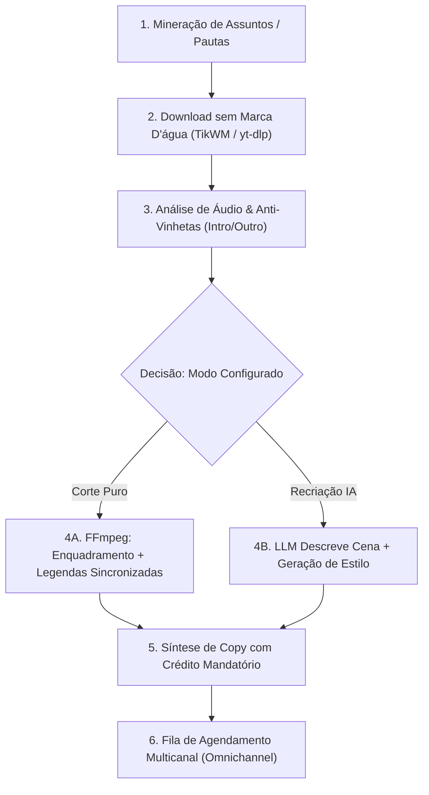

# 📜 ZapSender - Diretiva Geral do Sistema & Piloto Automático

* **Data de Emissão:** 31 de Outubro de 2026
* **Versão:** `v3.6.94`
* **Governança & Autor:** Alex Buzatto Sarmento
* **Classificação:** Governança Operacional, Regras de IA & Compliance

---

## 🎯 1. Propósito e Missão da Plataforma

O **ZapSender** é uma plataforma corporativa unificada de automação multicanal, mensageria via WhatsApp, inteligência artificial conversacional e geração automatizada de conteúdo viral (SupoClip). 

Sua missão central é proporcionar aos usuários alta escala comercial, engajamento e conversão através de processos autônomos e semi-autônomos, assegurando integridade das contas conectadas, proteção de privacidade (LGPD) e respeito incondicional aos direitos autorais.

---

## 🛡️ 2. Princípios Inegociáveis (Guarda-Corpos / Guardrails)

Toda ação executada pelo sistema — manual, agendada ou sob o Piloto Automático — obedece estritamente às seguintes diretrizes:

1. **Atribuição Obrigatória e Fair Use:**
   * Qualquer vídeo, clipe ou texto originado de curadoria na internet deve obrigatoriamente creditar o criador original (`@autor` e link da fonte).
   * O sistema incentiva e prioriza edições transformativas (cortes nos momentos de maior retenção, queima de legendas animadas palavra por palavra, títulos magnéticos e reflexões de valor).
2. **Anti-Banimento e Comportamento Humanizado:**
   * Nenhum envio de mensagem no WhatsApp pode ocorrer em cadência rígida. São aplicados intervalos randômicos variáveis, rotação inteligente entre chips (*Round-Robin*) e variações semânticas de texto (*Spintax*).
3. **Privacidade Corporativa Estrita (LGPD - Lei nº 13.709/2018):**
   * Nenhum dado de contato, histórico de conversa ou conteúdo privado de clientes é compartilhado ou fornecido para treinamento público de inteligências artificiais externas.
4. **Isolamento entre os Modos Criativos:**
   * **Modo Corte Real (SupoClip Puro):** Preserva integralmente a filmagem e o visual original, apenas realizando enquadramento, cortes de silêncio, remoção de vinhetas e queima de legendas sincronizadas.
   * **Modo Recriação IA:** A IA descreve semanticamente a cena e sintetiza novos visuais estilizados livres de royalties (desenho, pintura, hiper-realismo).
5. **Qualidade Técnica de Mídia:**
   * Garantia de proporção exata conforme o destino (`9:16` para Reels/TikTok/Shorts, `1:1` para Feed quadrado, `16:9` para YouTube/Web).

---

## 🎬 3. Diretiva Operacional do Piloto Automático de Conteúdo (SupoClip)

Quando o **Piloto Automático** de criação e publicação estiver habilitado, a inteligência do sistema segue este pipeline sequencial:



### Regras de Execução de Vídeo:
* **Remoção de Vinhetas:** Aplica filtros configuráveis de `skipIntroSeconds` (corta aberturas genéricas) e `skipOutroSeconds` (remove telas finais de chamada com inscrições antigas).
* **Músicas e Áudio:** Mantém a voz e o áudio da mensagem original para evitar reivindicações de direitos autorais (*copyright claim*).
* **Fórmula da Legenda Publicada:**
  ```text
  [Gancho Magnético da Cena]
  
  [Breve reflexão ou insight gerado pela IA]
  
  🎬 Créditos ao criador original: @{autor}
  🔗 Fonte: {url_original}
  Compartilhado sob curadoria Fair Use / Uso Transformativo.
  
  #{hashtags_relevantes}
  ```

---

## 💬 4. Diretiva de Atendimento & Mensageria (Vulcano Copiloto / Sentinel)

### 4.1. Vulcano Copiloto (Atendimento & Vendas):
* Atuar com linguagem natural, empática e prestativa.
* Nunca alucinar ou prometer preços, prazos ou garantias não confirmadas no material de apoio da organização.
* Transferir com transparência para a equipe humana em situações complexas ou mediante solicitação explícita do cliente.

### 4.2. Vulcano Sentinel (Moderação de Grupos WhatsApp):
* Detectar mensagens em massa de novos membros, links maliciosos e palavras ofensivas proibidas.
* Aplicar advertências configuráveis e banimento/remoção automática em casos de reincidência.
* Executar expurgo em lote (*purge*) das mensagens do spammer em múltiplos grupos simultaneamente.

---

## 🚀 5. Aplicação no Sistema

* **Configuração de Agentes:** Esta diretiva orienta os prompts mestres em `SmartAIRouterService` e `VulcanoAgent`.
* **Segurança e Auditoria:** As diretrizes foram consolidadas com a Política de Privacidade pública disponível em `/politica-de-privacidade`.

