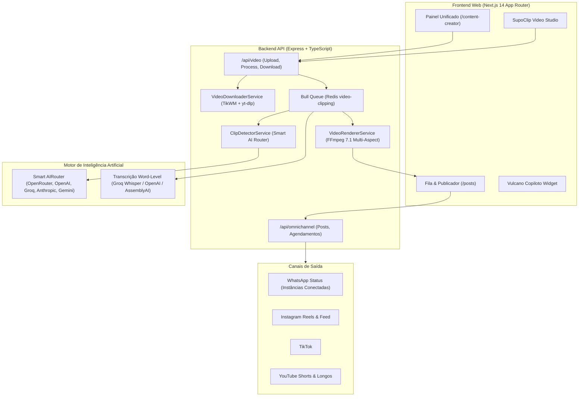

# 🚀 ZapSender — Visão Geral do Projeto, Arquitetura & Propósito Estratégico

## 📌 1. O Que É o ZapSender
O **ZapSender** é uma plataforma All-in-One de **Marketing Conversacional, Automação Omnichannel, Gestão de Comunidades e Fábrica Autônoma de Conteúdo Viral com Inteligência Artificial**.

Projetado para operar em escala empresarial e multi-tenant, o sistema une infraestrutura robusta de disparo de mensagens, aquecimento preventivo de chips de WhatsApp, agentes conversacionais inteligentes e uma esteira completa de criação, edição e publicação autônoma de conteúdos audiovisuais.

---

## 🎯 2. O Propósito Central do Usuário (A Visão Estratégica)
O objetivo do usuário com o ZapSender vai além de um simples disparador de mensagens:
> **"Criar uma Fábrica Autônoma de Conteúdo e Viralização Fim a Fim (End-to-End Content Machine) onde a IA busca o assunto na internet, extrai ou recria o vídeo, edita com qualidade cinematográfica, protege contra direitos autorais e agenda a publicação em múltiplos canais no piloto automático."**

### Pilares Fundamentais do Propósito:
1. **Automação Completa (Hands-Off):** O sistema deve ser capaz de operar no *Piloto Automático*, pesquisando pautas em alta, baixando ou gerando conteúdos e enfileirando publicações programadas sem atrito manual diário.
2. **Mineração de Redes Sem Marca d'Água:** Capacidade de importar vídeos originais limpos do **TikTok (sem watermark)**, **YouTube/Shorts**, **Kwai** e **Instagram Reels** usando `VideoDownloaderService` e `yt-dlp`.
3. **Dois Modos de Produção Configuráveis:**
   - **Modo 1: Corte & Repost Puro (Vídeo Real):** Preserva 100% o material original, cortando ganchos de alta retenção nos primeiros 3 segundos, removendo vinhetas e aplicando legendas dinâmicas (estilo Hormozi/MrBeast).
   - **Modo 2: Recriação com IA (Faceless / Cenas):** A IA reescreve a narrativa em roteiro autoral, sintetiza voz neural realista (TTS) e gera novas cenas e ilustrações (estilos Bíblico, Anime, 3D Pixar, Cinematográfico).
4. **Segmentação por Nichos:** O Piloto Automático deve alimentar canais com identidades temáticas bem definidas:
   - 🕊️ *Religioso / Mensagens Bíblicas / Fé*
   - 🎬 *Séries / Filmes / Curiosidades de Cinema*
   - 🎨 *Desenhos / Animações / Histórias Visuais*
   - 💼 *Negócios, Vendas & Marketing Digital*
5. **Compliance de Fair-Use & Atribuição Obrigatória:** Todo conteúdo minerado deve obrigatoriamente creditar o criador original (`@autor` e link da fonte) nas copys e legendas geradas, garantindo ética, proteção contra strikes e apoio ao algoritmo das plataformas.
6. **Escudo Anti-Copyright & Anti-Vinheta:**
   - Pular automaticamente aberturas/vinhetas repetitivas (primeiros 3s a 15s) e telas finais de inscrição (últimos 5s a 15s).
   - Preservar o áudio com qualidade ou aplicar trilhas royalty-free.
7. **Qualidade Máxima & Multi-Proporção:**
   - Renderização FFmpeg calibrada em **CRF 20** com áudio **AAC 192k** para evitar compressão pixelada.
   - Suporte a **9:16 Vertical** (Reels/TikTok/Shorts/Status), **1:1 Quadrado** (Feed/LinkedIn), **4:5 Retrato** (Feed Alto) e **16:9 Horizontal** (YouTube clássico/Cursos).
8. **Publicação Flexível:** Capacidade de postar em uma rede isolada ou disparar simultaneamente para todos os canais integrados.

---

## 🏗️ 3. Arquitetura do Sistema

---

## 🧩 4. Módulos Principais do ZapSender

### 4.1. Estúdio Criativo & SupoClip Vídeos (`/content-creator`)
* **Hub Unificado:** Centraliza Criação Autoral, Radar de Hype Global, Tropicalizador de Virais, Pesquisa na Web, Piloto Automático e o estúdio de corte de vídeos **SupoClip PRO**.
* **Importação Inteligente:** Suporta upload local até 500MB ou importação instantânea de links de TikTok (watermark-free), YouTube, Kwai e Reels.
* **Legendas Dinâmicas Queimadas:** Estilos Hormozi (amarelo/branco bold), MrBeast (verde/ciano neon), Minimalista (branco elegante), Neon e Sem Legenda.
* **Sinergia Transversal:** Ganchos virais detectados no corte de vídeo podem ser exportados para o gerador de posts autorais com 1 clique.

### 4.2. Agente Copiloto Vulcano & Sentinela IA
* **Vulcano Copiloto:** Agente de atendimento e assistente operacional capaz de executar comandos de negócio (consultar dados, acionar cortes de vídeo, disparar mensagens).
* **Vulcano Sentinel:** Moderação automática de grupos de WhatsApp, expulsa spammers, detecta links maliciosos e realiza purges em lote de mensagens.

### 4.3. Disparador em Massa & Aquecedor de Chips
* Disparo humanizado com intervalos randômicos, rotação de instâncias e aquecimento gradual para prevenção de banimentos.

### 4.4. Publicador Multicanal & Fila de Agendamento (`/posts` & `/scheduling`)
* Gestão de filas com status `PENDING`, `PROCESSING`, `COMPLETED`, `FAILED`.
* Disparo simultâneo ou individual para WhatsApp Status, Instagram, TikTok e Telegram.

### 4.5. Conformidade Legal, Privacidade & LGPD (`/politica-de-privacidade`)
* **Marco Legal:** Em estrita conformidade com a LGPD (Lei Federal nº 13.709/2018), Marco Civil da Internet (Lei nº 12.965/2014) e Diretrizes da Meta/WhatsApp.
* **Controlador vs. Operador:** Usuário contratante é o Controlador da base de leads/opt-in; o ZapSender atua como Operador tecnológico.
* **Privacidade Corporativa em IA:** APIs corporativas estritas sem compartilhamento de dados ou conversas para retreinamento público de LLMs.
* **Proteção Autoral e Fair Use:** Exigência mandatória de menção de créditos originais (`@autor` + link original) em vídeos e publicações de curadoria.
* **Segurança e Encarregado (DPO):** Criptografia TLS 1.3, senhas com bcrypt irreversível, isolamento multi-tenant e canal direto com o DPO (Alex Buzatto Sarmento).

---

## 💻 5. Stack Tecnológico e Dependências Críticas

| Camada | Tecnologia | Detalhes |
| :--- | :--- | :--- |
| **Monorepo** | Turborepo + npm workspaces | `apps/api`, `apps/web`, `packages/*` |
| **Frontend** | Next.js 14 (App Router), Tailwind CSS, Lucide | UI moderna, modo escuro, tokens CSS variáveis |
| **Backend** | Express 4, Node.js 20, TypeScript | Arquitetura de serviços, controllers e middlewares |
| **Banco de Dados** | PostgreSQL + Prisma ORM | Modelos relacionais com multi-tenancy nativo |
| **Filas & Cache** | Redis 7 + Bull Queue | Processamento assíncrono de renderização e disparos |
| **Vídeo & Áudio** | FFmpeg 7.1, yt-dlp, TikWM API | Transcrição word-level, layouts 9:16, 1:1, 4:5, 16:9 |
| **Container & Deploy**| Docker Swarm, Traefik v3, Portainer | Imagens versionadas no GHCR (`ghcr.io/alexbuzatto/...`) |

---

## 📜 6. Diretrizes para Novos Agentes e Desenvolvedores
1. **Sempre verificar o Cofre Obsidian antes de criar soluções isoladas:** Todas as regras arquiteturais, credenciais e decisões de design estão registradas em `E:\CofreObsidian`.
2. **Preservar a Unificação do Hub Criativo:** Não crie novos menus separados para ferramentas de conteúdo; mantenha tudo dentro de `/content-creator`.
3. **Respeitar os Dois Modos:** Ao trabalhar com geração e corte de vídeo, nunca force recriação por IA quando o usuário quiser apenas o corte puro do vídeo real.
4. **Deploy Rigoroso:** Utilize sempre o script [`.\docker-build-push.ps1`](file:///e:/ZapSender/docker-build-push.ps1), garantindo que os testes Vitest e a checagem TypeScript passem antes de subir uma nova release versionada.
5. **Diretiva Mestra e Governança:** Qualquer nova automação ou agente deve seguir as regras de atribuição fair use, moderação e conformidade descritas em [`ZapSender - Diretiva Geral do Sistema.md`](file:///E:/CofreObsidian/Memórias/ZapSender%20-%20Diretiva%20Geral%20do%20Sistema.md) e na [`Política de Privacidade LGPD`](file:///E:/CofreObsidian/Memórias/ZapSender%20-%20Politica%20de%20Privacidade%20e%20Conformidade%20LGPD.md).

